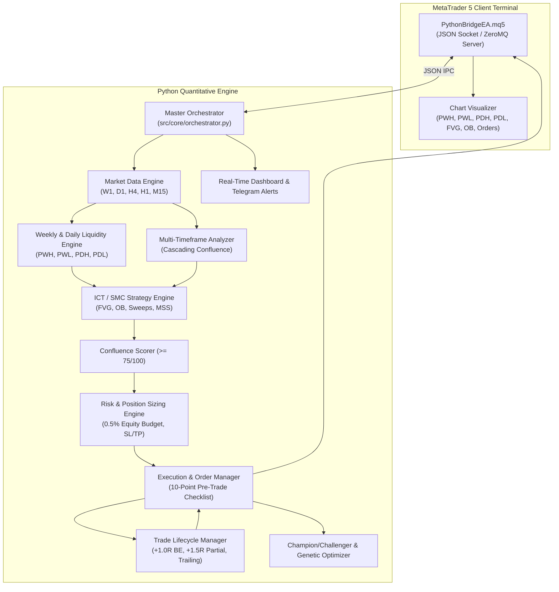

# Institutional Quantitative Trading System Architecture

## 1. System Overview
The Multi-Timeframe Algorithmic Day-Trading System is designed as a decoupled, event-driven trading platform connecting a Python quantitative engine to MetaTrader 5 via high-speed IPC (ZeroMQ / TCP Sockets).

## 2. Directory Layout & Boundaries
- `src/core/`: Strongly-typed contracts, config loaders, market data buffers, session clocks, volatility classification, news filter.
- `src/smc/`: Smart Money Concepts & Inner Circle Trader engines: W1/D1 liquidity levels, market structure (BOS, CHoCH, MSS), FVG/OB detection, MTF bias aggregator, confluence scoring.
- `src/risk/`: Capital preservation core: mathematically normalized lot sizing, portfolio risk bounds, circuit breakers, lifecycle position management.
- `src/learning/`: Statistical validation: performance analytics, champion/challenger gating, walk-forward splits, Monte Carlo permutations, genetic parameter optimizer.
- `src/execution/`: Transport layer: ZeroMQ/Socket bridge client, 10-point pre-trade checklist, order submission, simulation engine.
- `src/monitoring/`: Observability: CLI/terminal dashboard, Telegram alerts, report generation.
- `mql5/`: MetaTrader 5 Expert Advisor (`PythonBridgeEA.mq5`) with visual chart indicators.
- `config/`: JSON configuration templates with zero hardcoded credentials.
- `scripts/`: Operational tools (`start_bot.py`, `run_backtest.py`, `validate_readiness.py`, `backup.py`).
- `tests/`: Automated unit and integration test suite.
