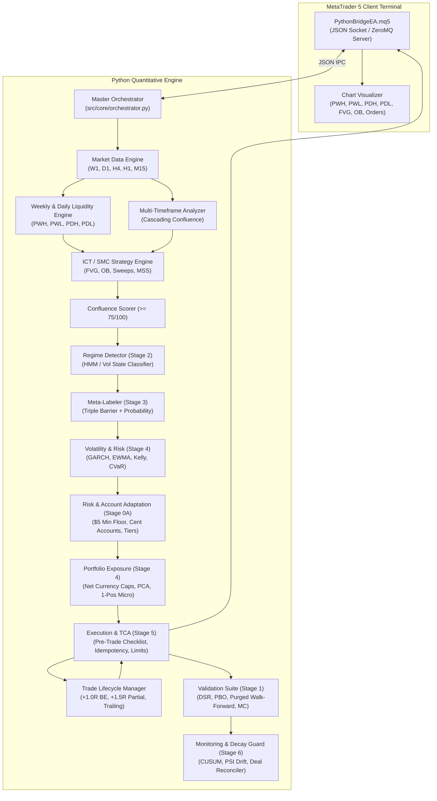

# Institutional Quantitative Trading System Architecture

## 1. System Overview
The Multi-Timeframe Algorithmic Day-Trading System is designed as a decoupled, event-driven trading platform connecting a Python quantitative engine to MetaTrader 5 via high-speed IPC (ZeroMQ / TCP Sockets).

## 2. Quantitative Upgrade Subsystems

### Stage 0A: Account-Size Adaptation ($5 Minimum Floor)
- **Universal Unit Normalization**: Cent account detection (USC, EUC, GBX) with 100:1 dollar conversion.
- **Account Tiers (`config/account_tiers.json`)**:
  - `BELOW_FLOOR` (< $5.00): Strict trading halt.
  - `MICRO` ($5 - $25): 2.0% target risk, 5.0% absolute ceiling.
  - `MINI` ($25 - $100): 1.5% target risk, 4.0% absolute ceiling.
  - `SMALL` ($100 - $500): 1.0% target risk, 2.0% absolute ceiling.
  - `STANDARD` ($500 - $5,000): 1.0% target risk, 1.5% absolute ceiling.
  - `LARGE` (> $5,000): 0.75% target risk, 1.0% absolute ceiling.
- **Boundary Hysteresis**: 5% buffer prevents tier-flapping near boundaries.
- **Affordability Scanner (`src/risk/affordability.py`)**: Classifies symbols into `TRADABLE`, `MARGINAL`, or `BLOCKED` based on ATR stop distance and broker contract specs.

### Stage 1: Modern Quantitative Validation Suite
- **Purged & Embargoed Walk-Forward Engine (`src/learning/validation/walk_forward.py`)**: Eliminates serial correlation and lookahead bias.
- **Deflated Sharpe Ratio (DSR)**: Bailey & Lopez de Prado (2014) correction for selection bias across multiple trials.
- **Probability of Backtest Overfitting (PBO)**: Combinatorial Symmetric Cross-Validation (CSCV).
- **Monte Carlo Ruin Engine**: 5,000 resamplings estimating breach probabilities for Demo (10%), Live (6%), and Prop (4%) drawdown limits.
- **Friction Stress Testing**: Stress testing at 1.0x, 1.5x, and 2.0x transaction friction.

### Stage 2: Dynamic Regime Detection
- **Multi-Feature Regime Classifier (`src/regime/features.py`)**: Realized volatility, ATR percentile, ADX, MTF trend slope, session code, spread ratio.
- **Gaussian Volatility State Classifier (`src/regime/models.py`)**: Maps market conditions into `SCALP`, `HOLD`, or `NO_TRADE`.
- **Shadow Mode Audit Trail**: Shadow records what the regime detector would have recommended without modifying orders until promoted.

### Stage 3: Meta-Labeling
- **Triple-Barrier Labeling (`src/learning/meta/labeling.py`)**: Labels trade opportunities via upper barrier (TP), lower barrier (SL), and vertical time barrier.
- **Strictly Causal Feature Extractor (`src/learning/meta/features.py`)**: Enforces zero forward lookahead bias through explicit timestamp assertions.
- **Calibrated Classifier (`src/learning/meta/model.py`)**: Platt-calibrated logistic model providing well-calibrated win probabilities and Brier score tracking.
- **Sizing Invariants**: Meta-model can only scale down risk (<= 1.0x) or skip; it can never increase risk above base limits.

### Stage 4: Volatility and Risk Modeling
- **Volatility Forecasting (`src/risk/volatility.py`)**: GARCH(1,1) conditional variance forecasting, RiskMetrics EWMA ($\lambda=0.94$), HAR-RV, and ATR fallback.
- **Fractional Kelly Criterion (`src/risk/kelly.py`)**: Mathematically derived allocation from out-of-sample expectancy. If expectancy <= 0, Kelly is strictly 0.0.
- **Drawdown Throttle (`src/risk/drawdown_throttle.py`)**: Multi-tiered stepped reduction (100% -> 70% -> 40% -> 0% pause at 80% buffer utilization) and 99% CVaR tail risk alerts.
- **Portfolio Exposure Limits (`src/risk/portfolio_exposure.py`)**: Micro/Mini accounts strictly limited to 1 open position. Net currency exposure caps, pairwise correlation gating (> 0.70 rejection), and PCA concentration ratio ($\lambda_1 / \sum \lambda_i$).

### Stage 5: Execution Quality and Analytics (TCA)
- **Transaction Cost Analysis (`src/execution/analytics/tca.py`)**: Per-order auditing of intended vs filled price, slippage points and USD, latency, and retcodes.
- **Time-of-Day Spread Model (`src/execution/analytics/spread_filter.py`)**: Identifies illiquid rollover hours (21:00-23:00 UTC) and spreads > 2.0x hourly median.
- **Limit Orders with Expiry (`src/execution/analytics/limit_orders.py`)**: Passive entries placed at structural pullbacks with expiration.
- **Idempotency Manager (`src/execution/analytics/idempotency.py`)**: Deterministic SHA-256 request IDs guaranteeing zero duplicate fills.

### Stage 6: Monitoring and Decay Detection
- **Decay Guard (`src/monitoring/decay_guard.py`)**: CUSUM control chart tracking live rolling expectancy against baseline OOS distribution. 3-tier alerts: Warning (2.0s), Reduced Risk (2.5s), Pause (3.0s, requires operator `/run`).
- **Feature Drift Detector (`src/monitoring/feature_drift.py`)**: Population Stability Index (PSI) and Kolmogorov-Smirnov test over rolling 100 bars.
- **Deal Reconciler (`src/monitoring/reconciliation.py`)**: Audits MT5 deal history against bot orders to detect price drift, volume discrepancies, or rogue deals.
- **LLM Trade Reviewer (`src/monitoring/llm_reviewer.py`)**: Structured weekly review prompt template; remains completely silent when unconfigured.

### Stage 7: Advanced Multi-Phase Execution Subsystems (v3.3 Upgrade)
1. **Structure Confirmation State Machine (`src/smc/structure_confirmation.py`)**: Multi-stage state machine (`CHOCH_WARNING -> PULLBACK -> BOS_CONFIRMED -> FAILED_TRAP`) preventing fakeout traps and anchoring structural stop loss to the confirmed LH/HL.
2. **Locked Trade Plan (`src/core/contracts.py`)**: Immutable `TradePlan` dataclass binding entry, SL, TP, lots, risk %, R:R, and structural state before execution. All lifecycle shifts tracked as explicit `PlanAmendment` records.
3. **Monte Carlo Replay Gate (`src/risk/replay_gate.py`)**: Vectorized block-bootstrap simulation over 10,000 empirical M15 price paths. Gating on $P(\text{target}) > P(\text{stop}) + \text{edge}$ and expected R under 2 seconds.
4. **Human Confirm Gate & Paper Shadow Journal (`src/monitoring/shadow_journal.py`, `src/notifications/telegram_service.py`)**: Interactive 120s operator approval in LIVE/PROP modes with `/confirm_mode`, and forward tracking of taken and rejected setups via `/shadow_report`.
5. **Multi-Symbol Opportunity Scanner (`src/smc/symbol_scanner.py`, `src/smc/news_filter.py`)**: 5-factor scoring model ranking symbols on M15 close with high-impact macroeconomic news calendar blackout window.
6. **Exit Machine (`src/risk/trade_management.py`)**: Configurable optional exit rules: Time Stop (X bars), End-of-Session Flatten, 1.0R Partial + BE, Structure-Based Swing Trailing.

### Stage 8: Pattern Recognition & Confluence Architecture (v3.4 Upgrade)
1. **Contracts & Pluggable Registry (`src/patterns/contracts.py`)**: Strongly-typed `PatternResult` and `ScoredPattern` dataclasses with centralized registry (`@PatternRegistry.register`) allowing zero-overhead extension across `CANDLE`, `CHART`, and `HARMONIC` pattern families.
2. **Candlestick Engine (`src/patterns/candlesticks.py`)**: 51 vectorized closed-candle pattern detectors with ATR-normalized body/shadow metrics, prior trend qualification, and Forex gap-equivalent logic.
3. **Chart & Harmonic Pattern Engine (`src/patterns/chart_patterns.py`)**: Closed-candle swing-based detectors (Head & Shoulders, Double/Triple Tops/Bottoms, Triangles, Wedges, Flags, Rectangles, Channels, Harmonics) with textbook measured-move target projection and structural invalidation levels.
4. **Context Scorer & Confluence Engine (`src/patterns/context.py`)**: 0-100 rubric synthesizing Order Block/FVG proximity, HTF trend alignment, BOS confirmation state, confirmation candle close, volume expansion, and killzone regime. Incorporates automatic overlap de-duplication and opposing signal conflict resolution.
5. **Strategy & Execution Hook (`src/patterns/integration.py`, `src/smc/strategy_engine.py`)**: Strangler adapter delivering `PATTERN_CONFLUENCE` setups to the execution pipeline without modifying existing signatures, with master switch off by default.
6. **Empirical Evaluation Pipeline (`scripts/evaluate_patterns.py`)**: Multi-regime walk-forward splits reporting sample size, win rate, expectancy, profit factor, and max drawdown with transaction costs.

### Stage 9: Session-Aware Trading Architecture & Affinity Matrix (v3.5 Upgrade)
1. **Dual Session Engine (`src/core/sessions.py`, `config/sessions.json`)**:
   - Named profile `ist_reference`: Static UTC windows derived from IST reference hours (Asia 00:00–09:00 UTC, London 06:00–12:00 UTC, New York 12:30–17:30 UTC, Best Window 12:30–17:30 UTC).
   - Named profile `market_local_dst`: Dynamic local market hours using deterministic rules and `zoneinfo` (`Europe/London`, `America/New_York`) adapting automatically to DST shifts.
   - Comprehensive overlap detection (London/NY overlap) and fail-safe broker offset verification.
   - Transition protections: Monday open skip (30m), Friday cutoff (20:00 UTC), handover cooldown (15m), and swap rollover blackout (21:55–22:15 UTC).
2. **Session × Symbol Affinity Engine (`src/core/session_affinity.py`, `config/session_affinity.json`)**:
   - Normalized symbol alias resolution mapping broker symbols (`EURUSD.m`, `GOLD`, `USTEC.m`) to canonical assets.
   - Dual gating modes: `scored` (continuous confluence multiplier with minimum weight floor) vs `strict` (binary gate requiring weight $\ge 0.80$).
   - Cash-open blackout protection for equity indices (`NAS100`, `US30`) 30 minutes before and after 14:30 UTC cash open.
3. **Session Liquidity Engine (`src/smc/session_liquidity.py`)**:
   - Computes daily Asian range (High, Low, Midpoint, Range pips) and registers BSL/SSL liquidity zones.
   - London Judas Swing detection: Sweeps of Asia range followed by closed candle rejection inside the range.
4. **Session Risk & Correlation Guard (`src/risk/session_risk.py`, `src/execution/order_manager.py`)**:
   - Per-session trade count ceiling (max 2), consecutive loss cap (max 2), session loss budget (1.0% balance), and session risk multipliers (0.5x Asia, 1.0x London/NY).
   - Cross-pair correlation guard preventing duplicate same-direction risk in correlated clusters (e.g. `EURUSD` + `GBPUSD`).
   - Pre-trade checklist gates #13–#16 seamlessly integrated into the 16-point execution checklist.
5. **Interactive Telegram Controls & Walk-Forward Evaluator (`src/notifications/telegram_service.py`, `scripts/evaluate_sessions.py`)**:
   - Telegram commands: `/session`, `/sessionstats`, `/sessionmode`, `/sessionprofile`.
   - Walk-forward multi-regime simulation comparing Baseline vs Scored vs Strict, exporting to `reports/session_performance.json` and feeding `ChampionChallengerEngine`.

### Stage 10: Fast Mode — Low-Latency Scalping Execution Layer (v3.6 Upgrade)
1. **Low-Latency Execution Path (`src/execution/persistent_socket.py`, `src/execution/async_queue.py`, `mql5/Experts/PythonBridgeEA.mq5`)**:
   - `NonBlockingExecutionQueue`: Moves Telegram notifications, journaling, and chart drawing off the critical order path (`< 5µs` enqueue overhead).
   - `PersistentBridgeSocket` (`TCP_NODELAY`) & `LowLatencyOrderDispatcher`: Deterministic idempotent `client_order_id`, auto-detection/fallback across filling modes (`FOK`, `IOC`, `RETURN`), mandatory server-side SL/TP and `stops_level`/`freeze_level` validation, bounded requote retries with live quote/spread re-validation, and stage-by-stage nanosecond latency telemetry.
2. **Scalp Entry Engine (`src/execution/fast_mode_engine.py`)**:
   - `PrecomputedSymbolState` cache refreshed on bar close; `M1`/`M5` closed-bar evaluation aligned with `M15`/`H1` bias, confirmed BOS after CHoCH, FVG/OB mitigation, or displacement + rejection pattern, spread $\le 10\%$ of SL filter, ATR floor/ceiling bounds, post-trade cooldown, and hourly rate cap.
3. **Fast Tick Exit Manager (`src/execution/fast_exit_manager.py`)**:
   - Tick-driven exit engine enforcing break-even at `+0.5R` above spread+buffer, `50%` partial TP at `+1.0R` + confirmed swing/ATR trailing, time stop, momentum-failure exit, spread-spike SL freeze protection, session-end/rollover/news flatten, and MFE/MAE tracking.
4. **Speed Risk Guardrails (`src/risk/fast_risk_guard.py`)**:
   - Strict downward volume rounding (`normalize_volume_down`), `ForceMinLotRiskFloor` + small-account minimum balance calculator & `DECISION` message, projected margin floor ($\ge 300\%$), critical margin flatten floor ($\le 150\%$), combined open-risk cap, anti-stacking/anti-grid/anti-martingale rules, consecutive-loss circuit breaker, and equity-velocity kill switch ($> 2.5\%$ floating loss in `60s`).
5. **Always-On Watchdog & Remote Controls (`src/execution/watchdog.py`, `src/notifications/telegram_service.py`)**:
   - Heartbeat monitor, auto-reconnect with full state reconciliation against MT5 positions, stale-tick guard (`5s`), clock drift sanity check, weekend guard, and graceful shutdown cancelling orphaned pending orders.
   - Telegram commands: `/fastmode on|off`, `/pause`, `/resume`, `/flatten` (strict `chat_id` verification), `/fastquality`, and `/margin`.
